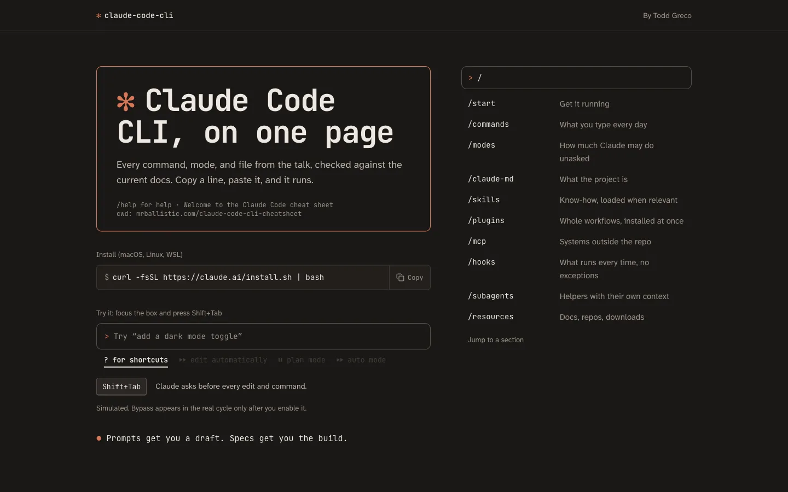
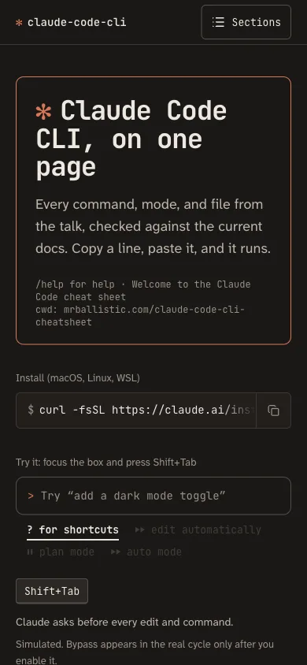

# Claude Code CLI, on one page

A desk reference for [Claude Code](https://code.claude.com) in the terminal. It covers every command, permission mode, and config file you reach for day to day, all copy-ready and checked against the official docs.

**→ [mrballistic.com/claude-code-cli-cheatsheet](https://mrballistic.com/claude-code-cli-cheatsheet/)**



It started as the companion to a May 2026 meetup talk and was last checked against the docs in October 2026.

## What's on it

The page is ordered the way you'd adopt Claude Code, one layer at a time:

| Section | What you get |
| --- | --- |
| **Install** | The native installer, Homebrew, Windows, and the launch flags (`-c`, `-r`, `-p`) |
| **Commands** | The slash commands and keyboard shortcuts worth knowing first, plus fast mode |
| **Modes** | All six permission modes with their `--permission-mode` values, and how auto mode decides |
| **CLAUDE.md** | Where the files live, a starter template, and what makes a good one |
| **Skills** | A real `SKILL.md`, where skills live, and how Claude picks them up |
| **Plugins** | [Superpowers](https://github.com/obra/superpowers) and [Impeccable](https://impeccable.style), the author's picks |
| **MCP** | Adding servers, the three scopes, current install commands for popular servers, and a FastMCP starter |
| **Hooks** | The events you'll use most and two drop-in `settings.json` examples |
| **Subagents** | The built-in types and a custom agent file |

Every command has a copy button. Shell commands start with `$` and Claude Code prompt input starts with `>`, so you always know where to paste.

## How it's built



The design borrows Claude Code's own interface: the welcome box, the rounded prompt box, the status line, and the `/` menu. The palette is warm charcoal with Claude's terracotta, and the whole page passes WCAG AA contrast. It works without JavaScript and respects reduced-motion settings. The redesign began with an [Impeccable](https://impeccable.style) critique; `DESIGN.md` records the system.

- **[Astro 7](https://astro.build)**, fully static, TypeScript strict, no client framework
- **Tailwind CSS 4**, with every colour defined as a CSS variable
- **JetBrains Mono** for anything you type, **Atkinson Hyperlegible Next** for prose
- All copy lives in [`src/lib/constants.ts`](src/lib/constants.ts). The page also publishes [`/llms.txt`](https://mrballistic.com/claude-code-cli-cheatsheet/llms.txt) from the same data, so agents can read it without parsing HTML.
- Open Graph, Twitter cards, and JSON-LD (`TechArticle`) for sharing and search

<br clear="right" />

## Run it locally

```bash
npm install
npm run dev        # http://localhost:4321/claude-code-cli-cheatsheet/
npm run check      # types and .astro diagnostics
npm run build      # static site in dist/
npm run build:og   # regenerate the social preview image
```

## Spot something out of date?

Claude Code moves fast. If a command has changed, [open an issue](https://github.com/mrballistic/claude-code-cli-cheatsheet/issues) with a link to the docs page, or send a PR that edits `src/lib/constants.ts`.

## Deploying

Releases are tag-driven, the same model as mrballistic.com. Bump `version` in `package.json`, commit to `main`, then:

```bash
git tag -a v1.0.1 -m "…" && git push origin v1.0.1
```

[`deploy.yml`](.github/workflows/deploy.yml) checks that the tag is on `main` and matches `package.json`. It then builds the site and rsyncs `dist/` to `/var/www/html/claude-code-cli-cheatsheet/` as `mrballistic-deploy`, using the same key as mrballistic.com. The sync only adds files; `--delete` runs only inside `_astro/` to prune stale hashed assets. The secrets (`SSH_PRIVATE_KEY`, `SSH_KNOWN_HOSTS`) live in a `production` environment that admits only `v*` tags. Pushes and PRs run [`ci.yml`](.github/workflows/ci.yml), which builds the site and deploys nothing.

## License

[MIT](LICENSE) © Todd Greco
